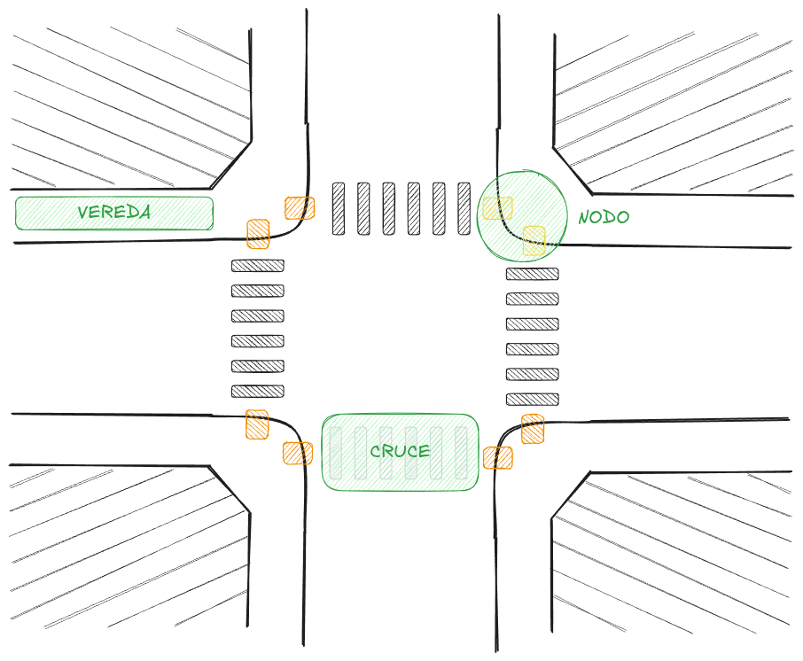
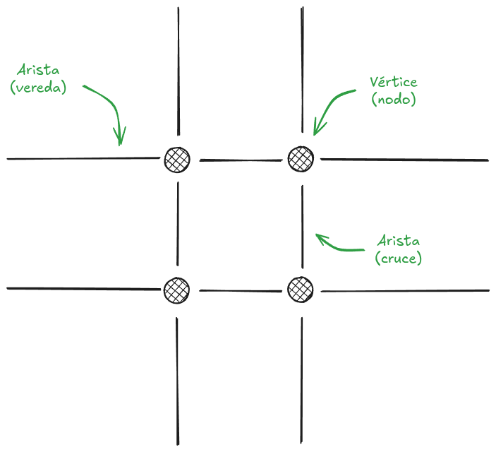
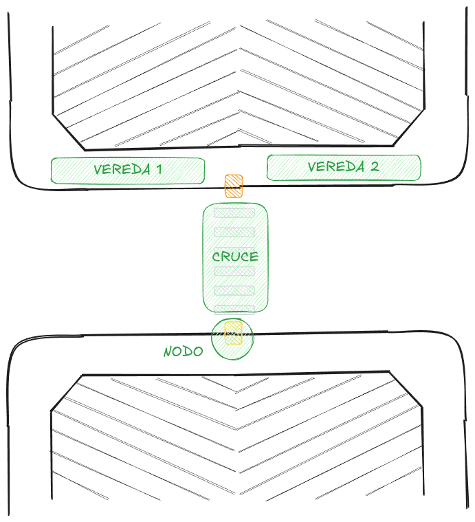
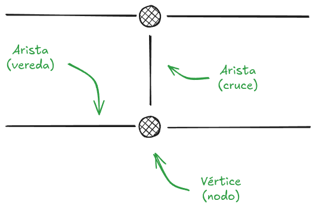

# Modelo de datos

> Documento temático. Define las convenciones del esquema de la base de datos y cómo
> se representa cada tipo de dato cerrado. Es el estado vivo de esas decisiones: se
> edita en su lugar cuando cambian. Se complementa con
> [01-diagramas.md](01-diagramas.md), que contiene el DER y los diagramas de estados,
> con [02-stack-y-estructura.md](02-stack-y-estructura.md), que define el acceso a
> datos, y con [00-reglas-documentacion.md](00-reglas-documentacion.md).

## 1. Alcance

Este documento responde:

- **Qué convenciones** rigen el esquema: idioma de los valores, ausencia de dato y
  baja lógica (§2).
- **Cómo** se representa un conjunto cerrado de valores, y con qué criterio se elige
  entre las tres formas posibles (§3).
- **Qué** forma tiene cada campo cerrado del modelo, y por qué (§4).
- **Cómo** se administra un enum: orden, agregar, renombrar y quitar valores (§5).
- **Qué** forma tiene un catálogo y cómo se da de baja una fila (§6).
- **Cómo** se escribe una migración: formato, nombres, marcas de tiempo y
  `updated_at` (§7).

No contiene el DER —eso es [01-diagramas.md](01-diagramas.md) §3 y su fuente en
`docs/diagrams/01-DER.mmd`— ni las reglas de negocio que usan estos valores: las
transiciones de estado están en los diagramas `05-est-*.mmd` y los pesos de ruteo se
deciden en el issue correspondiente (§7).

## 2. Convenciones del esquema

| Convención | Regla |
| --- | --- |
| Idioma de identificadores y valores de máquina | Inglés ([02](02-stack-y-estructura.md) §5) |
| Idioma del texto de contenido | Español, en columnas `name_es` |
| Ausencia de dato | `NULL`. Nunca un valor centinela (`0`, `''`, `'-'`, `'UNKNOWN'`) |
| Baja lógica | `deleted_at`. Nunca un estado ni un booleano `is_deleted` |
| Baja de una fila de catálogo | `is_active`, porque la FK tiene que seguir resolviendo (§6) |
| Marcas de tiempo | `created_at` y `updated_at` en toda tabla mutable; `deleted_at` si hay baja lógica |

La regla de `NULL` es la que más se rompe, y conviene tenerla explícita: **`NULL` es
ausencia de dato; un valor del enum es un dato del dominio**. Por eso ningún enum
lleva un miembro que signifique "no sé", y por eso "no accesible" (`NONE`) y "sin
relevar" (`NULL`) son estados distintos y no se pueden confundir.

## 3. Los tres casos

Un conjunto cerrado de valores se representa de una de tres formas. El criterio **no**
es cuánto cambia, sino qué es el valor:

| Caso | Representación | Cuándo |
| --- | --- | --- |
| **Vocabulario del dominio** | `enum` de PostgreSQL | Cerrado, sin atributos propios, el código lo interpreta y hay que poder ordenarlo o compararlo |
| **Catálogo** | Tabla de referencia + FK | El valor tiene identidad propia, lleva atributos, o lo edita un moderador sin deploy |
| **Código de una fuente externa** | El tipo nativo del código + `CHECK` | El alfabeto lo fija la fuente y el sistema solo lo transporta |

Hay una razón técnica, además de las de diseño, para preferir el enum sobre
`varchar` + `CHECK` cuando corresponde: los tipos de la base se **generan** para
Kysely. Un generador traduce un enum nativo a una unión de literales
(`'FULL' | 'PARTIAL' | 'NONE'`); una restricción `CHECK` sobre `varchar` le es
invisible y la columna queda tipada como `string`. Con `CHECK`, la restricción existe
en la base pero se pierde justo en la capa donde se escriben las consultas.

## 4. Decisión por campo

### 4.1 Enums

Un solo tipo por vocabulario, compartido por todas las tablas que lo usan:

| Tipo | Valores, en orden de declaración | Se usa en |
| --- | --- | --- |
| `accessibility_level` | `FULL`, `PARTIAL`, `NONE` | `kerb_nodes`, `sidewalks`, `crossings` |
| `obstacle_severity` | `MINOR`, `MODERATE`, `CRITICAL` | `obstacles` |
| `report_status` | `PENDING`, `APPROVED`, `UNDER_REPAIR`, `RESOLVED`, `REJECTED` | `reports` |

Los tres son **nullable**, y el `NULL` significa "no determinado": nadie relevó ese
nodo, esa vereda o ese cruce. No se usa un valor del enum para decirlo.

**`accessibility_level` en las tres tablas.** Antes, `kerb_nodes` tenía un ternario y
`sidewalks` y `crossings` un booleano `is_accessible`. El booleano no es una versión
de dos valores del ternario: es un ternario con un valor prohibido, y el valor
prohibido —nadie lo relevó— es el caso más común al importar OpenStreetMap. Un
booleano obliga a escribirlo como `false`, y entonces una vereda sin datos queda
igual que una sin rampa: en una aplicación de accesibilidad ese es el peor default
posible, porque el ruteo evita tramos que quizá están en buen estado.

`PARTIAL` es el valor que justifica el ternario: una vereda angosta o con desnivel
parcial no es intransitable, es transitable con penalización. Cuánto penaliza cada
nivel se decide en el modelo de peso de las aristas (§7).

**`is_verified` es otro eje y no se reemplaza.** Dice procedencia —"un moderador
comprobó este valor"— no accesibilidad. Un elemento puede tener nivel `PARTIAL`
importado de OSM sin que nadie lo haya verificado, y la inversa: el importador no
debería inventar un nivel. Por eso `accessibility_level` y `is_verified` se guardan
por separado y ninguna de las dos columnas se usa para significar lo de la otra.

**`report_status` no incluye la baja.** La baja de un reporte es `deleted_at`, no un
estado: si `DELETED` fuera un valor del enum, habría dos fuentes de verdad para "este
reporte está borrado". Los diagramas de estados sí muestran la baja como estado final
del ciclo de vida, y está bien: el ciclo de vida incluye la baja, pero el enum no.

### 4.2 Catálogos

| Tabla | Reemplaza | Filas iniciales |
| --- | --- | --- |
| `obstacle_types` | `obstacles.type` (`varchar`) | `POTHOLE`, `TREE`, `STEP`, `STEEP_SLOPE`, `NARROWING` |
| `tutorial_categories` | `tutorials.category` (`varchar(30)`) | Ninguna: se siembran al definir la carga de tutoriales |

**`obstacles.type` va a catálogo** porque el tipo no es solo una etiqueta: va a llevar
atributos (nombre para mostrar, y más adelante su efecto en el ruteo) y va a crecer
por datos —una barrera nueva no debería esperar un deploy—. Como `varchar` no admite
ni lo uno ni lo otro, y como enum no admite atributos, la tabla de referencia es la
única forma que cubre los dos casos.

**`tutorials.category` va a catálogo** por la misma razón, con un argumento propio: la
categoría la crean, editan y desactivan los moderadores. Un enum obligaría a una
migración cada vez que alguien agrega una categoría de video.

### 4.3 Los campos que se eliminan

Dos campos del DER original se eliminaron, y se documenta acá porque quitarlos es una
decisión de esquema, no un detalle.

**`sidewalks.side`.** El "lado" de una vereda no es un atributo de la vereda: es una
**relación entre tres cosas** —la vereda, la calzada y quien mira—. Una columna guarda
atributos, no relaciones, y por eso el valor almacenado solo puede ser correcto para
uno de los dos sentidos de circulación. Los casos que lo rompen no son excepciones: en
una calle de doble sentido no hay un lado único, una vereda entre carriles no es ni
izquierda ni derecha, y para un peatón que camina contra el sentido de la calle la
izquierda queda a su derecha.

Lo único que sobrevive del concepto es la convención de OpenStreetMap
(`sidewalk:left` / `sidewalk:right`), que es relativa a la dirección en que el way
fue digitalizado. Es determinista, pero es un **artefacto del import**: no sirve para
la interfaz y cambia si alguien re-digitaliza el way. El importador lo sigue leyendo
para ubicar las geometrías; después del import no lo usa nadie.

Lo que ve el peatón **se calcula y no se guarda**: la pierna de la ruta ya tiene una
dirección (de A a B) y la vereda tiene geometría, así que el lado es un producto cruz
entre dos vectores. Se recalcula en cada consulta, no se desactualiza y no ocupa una
columna.

También se descartó distinguir por numeración par o impar: la numeración es de la
calle, no de la vereda, y una esquina pertenece a las dos.

**`sidewalks.width`.** Un ancho por tramo es un promedio, y la vereda real se angosta
y se ensancha dentro de la misma cuadra: en el microcentro el promedio es razonable, en
un barrio no. El problema no se arregla con otro tipo de dato.

Pero el argumento que decide es otro: para que el ancho aporte algo tiene que
**alimentar el costo del ruteo**, y eso exige que alguien haya medido la vereda.
OpenStreetMap casi nunca trae el ancho, y relevar anchos a mano no está en el alcance
de ninguna fase. El resultado previsible era una columna que existe, que nadie llena,
y que en seis meses alguien iba a encontrar en el DER preguntando si estaba rota.

La accesibilidad ya expresa el resultado: una vereda demasiado angosta para una silla
de ruedas es `PARTIAL` o `NONE`. El ancho solo hace falta si se quiere *calcular* el
nivel en vez de relevarlo. Agregar la columna después es aditivo y barato; y si el
ruteo llegara a necesitar el dato, probablemente no sea una columna sino muestras a lo
largo de la arista.

### 4.4 El modelo en la calle

El DER dice qué tablas hay; estos esquemas dicen **qué representa cada una**. Lo
primero es la calle como la ve una persona; el mapeo al grafo viene después.

**Una intersección de dos calles.** Cuatro cordones (uno por esquina), cuatro cruces y
las veredas que llegan a cada uno. Las rampas están en amarillo y los nodos en verde:
lo que ilustra es que **varias rampas de una misma esquina son un solo `kerb_node`**,
con un solo nivel de accesibilidad.



El mismo lugar como grafo: los nodos son los vértices, los cruces las aristas que
forman el cuadrado del cruce, y las veredas las que salen hacia afuera.



**Un cruce a mitad de cuadra.** Acá se ve el caso que más cuesta: dos nodos que **no
son esquinas**. Un cordón existe donde se conecta algo, no donde hay una manzana.



Y su grafo: el cruce es la arista vertical, y la vereda queda **partida en dos aristas**
porque el nodo corta el tramo.



Dos consecuencias que se desprenden de esos dibujos y que conviene tener presentes:

- **Un solo nivel por nodo, aunque tenga dos rampas.** Si la rampa hacia un cruce está
  bien y la del otro no, un único `accessibility_level` miente en una de las dos
  direcciones. Es la simplificación que se acepta para el MVP; para que falle del lado
  seguro, el nivel del nodo se registra por el **peor caso** de sus rampas: ante la
  duda, el ruteo evita el paso. Revisar cuando el relevamiento muestre esquinas con
  rampas muy distintas entre sí.
- **Una vereda se corta en cada nodo.** El importador no puede mapear "una way de OSM =
  una vereda": tiene que cortar la way en cada nodo, incluidos los que crea un cruce a
  mitad de cuadra. Si no, la topología queda desconectada en esos puntos.

## 5. Administrar un enum

```sql
CREATE TYPE obstacle_severity AS ENUM ('MINOR', 'MODERATE', 'CRITICAL');

ALTER TABLE obstacles
  ADD COLUMN severity obstacle_severity NOT NULL;
```

**El orden de declaración es parte del contrato.** PostgreSQL ordena y compara los
enums por el orden en que se declararon los valores, así que `ORDER BY severity` y
`severity >= 'MODERATE'` funcionan sin columna de orden. Eso vale mientras el orden
declarado signifique algo: `MINOR < MODERATE < CRITICAL` es intencional.

**Agregar un valor** conserva el orden solo si se indica la posición:

```sql
ALTER TYPE obstacle_severity ADD VALUE 'EXTREME' AFTER 'CRITICAL';
```

Sin `BEFORE`/`AFTER`, el valor queda al final, y con eso `severity >= 'CRITICAL'`
empieza a incluir valores que antes no incluía. Por eso la posición no es opcional
como paso de migración.

En PostgreSQL 16, `ADD VALUE` corre dentro de una transacción, pero **el valor nuevo
no se puede usar en esa misma transacción**. Con `node-pg-migrate` eso significa: el
valor se agrega en una migración y se usa a partir de la siguiente.

**Renombrar** un valor: `ALTER TYPE ... RENAME VALUE 'VIEJO' TO 'NUEVO'`.
**Quitar** un valor no se puede hacer en el lugar: hay que crear un tipo nuevo,
migrar la columna y borrar el viejo. Por eso conviene que los valores estén bien
pensados antes de la primera migración, y por eso este documento existe antes que
las migraciones.

## 6. Forma de un catálogo

Los dos catálogos comparten la misma forma, para que el código que los consume sea
uno solo:

| Columna | Tipo | Para qué |
| --- | --- | --- |
| `id` | `int` PK | Lo que guarda la FK |
| `code` | `varchar(40)` único | Identificador estable en inglés. Es lo que viaja en la API |
| `name_es` | `varchar(80)` | Etiqueta para el portal. Es contenido, no mensaje de error |
| `is_active` | `boolean` | Baja lógica de la fila |
| `created_at`, `updated_at` | `timestamp` | Marcas de tiempo |

**`code` es inmutable una vez que hay filas apuntándolo.** Mientras no haya datos, un
`code` se corrige gratis; después, renombrarlo obliga a migrar datos y rompe a los
clientes que lo guardaron. La API expone `code`, nunca el `id`.

**La baja de un catálogo es `is_active`, no `deleted_at`.** Un obstáculo de 2019 sigue
apuntando a su tipo aunque ese tipo ya no se ofrezca: la fila tiene que seguir
existiendo y resolviendo. `is_active = false` la saca de los combos sin romper el
historial.

**`name_es` no contradice la regla del idioma.**
[02](02-stack-y-estructura.md) §5 reserva el inglés para los valores de máquina de la
API; el nombre de un tipo de barrera es contenido que el moderador edita, no un texto
de error que cada cliente traduce.

## 7. Convenciones de migración

Las migraciones son **SQL puro** ([02](02-stack-y-estructura.md) §7), viven en
`infra/migrations/` y las aplica `node-pg-migrate`. Un archivo es una unidad
temática —las tablas que resuelve un mismo issue— y contiene el up y el down con los
marcadores de la herramienta:

```sql
-- Up Migration
...
-- Down Migration
...
```

| Convención | Regla |
| --- | --- |
| Nombre del archivo | `<timestamp>_<nombre>.sql`, generado con `pnpm exec node-pg-migrate create <nombre> --migration-file-language sql`. El nombre va en kebab-case, en inglés |
| Marcas de tiempo | `timestamptz`, con `DEFAULT now()`. Nunca `timestamp` sin zona |
| Identidad | `integer GENERATED ALWAYS AS IDENTITY`, no `serial`, que deja la secuencia sin dueño visible |
| Geometrías | `geometry(<tipo>, 4326)` en la columna. El SRID no se repite en un `CHECK`: el tipo ya rechaza otro SRID. Ojo con el silencio: si la geometría no declara SRID, PostGIS le asigna 4326, así que un import con coordenadas proyectadas y sin SRID entra sin error |
| `updated_at` | Lo mantiene el trigger `set_updated_at()`, no el cliente |
| Nombres de constraints | Explícitos (`fk_<tabla>_<referencia>`, `<tabla>_<columna>_key`), para poder soltarlos en una migración futura |
| FK de una tabla de unión | `ON DELETE CASCADE` |
| FK hacia un catálogo | `ON DELETE RESTRICT`: el catálogo se da de baja con `is_active`, no borrando filas |
| Reversión | El down deja la base como estaba, en orden inverso y con `IF EXISTS` |
| Extensiones | `postgis` y `pgrouting` **no** las crean las migraciones: las habilita `infra/initdb/` al inicializar el volumen en desarrollo, y un administrador una sola vez en el servidor ([03](03-despliegue-y-operacion.md) §8). Una base creada a mano con `createdb` no las tiene, y la migración falla con `type "geometry" does not exist` |

**`updated_at` va con trigger, no en el código.** La función `set_updated_at()` se crea
en la primera migración y la reutilizan todas las tablas mutables: con dos sistemas
escribiendo (backend y portal), "acordarse de tocar `updated_at`" es una regla que se
rompe sola. La consecuencia a saber: el trigger es invisible para quien lee una query,
así que un `UPDATE` mueve `updated_at` aunque no se lo mencione.

**Una tabla cuyas columnas son todas inmutables no lleva `updated_at`.** `user_tutorials`
es el caso: solo tiene las dos FK y `created_at`, así que no habría nada que
actualizar y la columna sería peso muerto.

## 8. Lo que este documento no decide

- **Transiciones de estado.** Qué valores existen lo garantiza la base; qué
transiciones son válidas lo garantiza la máquina de estados en el servicio, con los
diagramas `05-est-*.mmd` como fuente y tests que las cubran. Que exista `RESOLVED` no
impide escribir `PENDING → RESOLVED`; eso no es trabajo del esquema.
- **Pesos de ruteo.** Cuánto penaliza un nivel de accesibilidad, si un tipo de
obstáculo bloquea o penaliza, y cómo se combinan. Los catálogos están listos para
recibir esas columnas cuando se decida.
- **Qué guarda un reporte.** El diagrama de actividades de C010
  ([04-act-C010.mmd](diagrams/04-act-C010.mmd)) hace que el usuario complete "tipo" y
  "lado de vereda", y `reports` no tiene columnas para ninguno de los dos. Es una
  inconsistencia previa a este documento y se resuelve al definir la migración de
  `reports`: o el reporte guarda esos datos como preclasificación para el moderador, o
  el diagrama describe solo una ayuda de la interfaz.
- **La identidad de los cruces para reimportar.** `sidewalks` guarda su `osm_way_id`,
  pero `crossings` no tiene ningún identificador externo: si el importador se vuelve a
  correr, no puede reconocer un cruce que ya existe salvo comparando geometría. Se
  resuelve en el importador, no en el esquema, pero conviene tenerlo anotado antes de
  escribir el importador de OpenStreetMap.

## 9. Documentos relacionados

- [01-diagramas.md](01-diagramas.md): el DER y los diagramas de estados.
- [02-stack-y-estructura.md](02-stack-y-estructura.md): stack, acceso a datos y
  convenciones de idioma (§5).
- [05-desarrollo.md](05-desarrollo.md): puesta en marcha, incluida la base.
- [07-plan-de-trabajo.md](07-plan-de-trabajo.md): cómo se derivan y se cierran las
  tareas de modelo.
